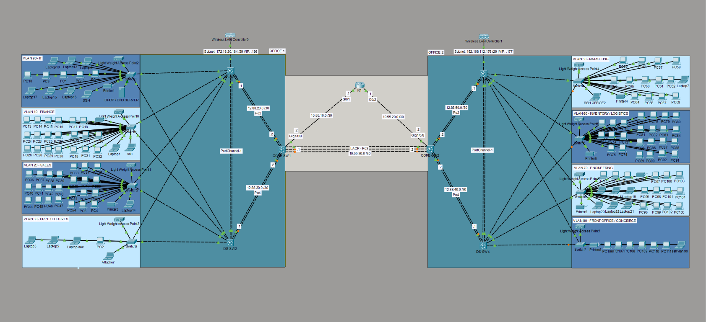

# Three Tier Campus Enterprise Network Design
A simulated two-office enterprise network built in Cisco Packet Tracer, designed around
the three-tier hierarchical model (access / distribution / core). The project covers
VLSM subnetting, inter-VLAN routing, first-hop redundancy, a routed distribution-to-core
design, dynamic routing across two sites, DHCP relay, wireless infrastructure, and
security hardening including port security, SSH device management, and management-plane
ACLs.
 
## Topology Overview
 

 
*Full topology: Office 1 (left) and Office 2 (right), joined through two core switches and router R1.*
 
- **Access layer:** 8 access switches, one per department, each single-homed to its
  office's distribution pair. Every access switch also carries a VLAN 99
  (Device-Management) SVI for its own SSH reachability.
- **Distribution layer:** DS-SW1/DS-SW2 (Office 1) and DS-SW3/DS-SW4 (Office 2). Each pair
  owns the Layer 2/Layer 3 boundary for its office — VLAN SVIs, HSRP, inter-VLAN routing,
  port security, and SSH management all live here.
- **Core layer:** Core-SW1 and Core-SW2, connected to each other via a directly-attached
  LACP EtherChannel (Po3) and to router R1 via two separate routed links. The core carries
  no VLANs and holds no department subnets — purely a fast, policy-free OSPF backbone.
- **Distribution-to-core links (Po2, Po4):** routed point-to-point links (`no switchport`),
  not trunks — keeps STP out of the core and gives each distribution switch its own OSPF
  adjacency to the core for fast, redundant convergence.
- **DS-SW1↔DS-SW2 / DS-SW3↔DS-SW4 (Po1):** kept as a Layer 2 trunk, not routed, because
  HSRP peers need to be in the same broadcast domain per VLAN to exchange hellos.
## Features Implemented
 
- **VLSM subnetting** — 8 department VLANs sized to actual headcount, contiguous
  allocation per office. See `docs/addressing-table.md` for exact device-count sizing per
  VLAN (PCs, printer, AP) against available host addresses.
- **Inter-VLAN routing** — Layer 3 SVIs on the distribution switches (`ip routing`
  enabled).
- **HSRPv2** — active/standby pair per office, priority + preempt, one VIP per VLAN as the
  client default gateway. Applied consistently to every VLAN, including the two added
  later (120, 99).
- **Rapid-PVST+** — per-VLAN root bridge placement pinned to the distribution layer
  (`spanning-tree vlan <id> priority`) for every VLAN present on the Po1 trunk.
- **OSPF (single area 0)** — full backbone adjacency across R1, both core switches, and
  all four distribution switches. Access-facing VLANs are `passive-interface`;
  router-to-router links are not.
- **DHCP** — per-department pools with a central DHCP/DNS server; each office's
  Wireless-Management VLAN is served locally from its active distribution switch with
  DHCP Option 43 for WLC auto-discovery.
- **Wireless** — one WLC2504 + one AP3702I per access switch, per office, on a dedicated
  Wireless-Management VLAN (120). SSID-per-department model, mapped to WLC dynamic
  interfaces matching the wired VLANs.
- **Port security** — sticky MAC learning, with violation mode and aging tuned per port
  role: `restrict` + inactivity aging on end-user ports, `shutdown` (no aging) on the
  DHCP/DNS server port, `restrict` + absolute aging on AP-facing ports.
- **SSH device management** — dedicated Device-Management VLAN (99) on every switch in
  both offices. RSA keys, local username/secret, `enable secret`, VTY and console lines
  set to `login local`, `transport input ssh`.
- **Management-plane ACL** — standard ACL applied to every switch's VTY lines
  (`access-class 10 in`), permitting only the two offices' Device-Management subnets and
  denying everything else. Rolled out to every switch in both offices; verified with
  `show access-lists 10` hit counters and live tests from both a permitted and a denied
  VLAN on multiple switches.
## Repository Structure
 
```
/topology/            Packet Tracer .pkt file(s)
/configs/             show running-config export per device (sanitized)
/docs/
  images/              Topology diagram used in this README
  addressing-table.md  Full VLAN, HSRP, and point-to-point addressing reference
  troubleshooting.md   Debugging log — real issues hit during the build and how they
                        were diagnosed and fixed
README.md
```
 
## Verification
 
- `show ip ospf neighbor` — FULL adjacency on every routed link (R1↔Core, Core↔Core,
  Core↔Distribution).
- `show standby brief` — one Active / one Standby per VLAN per distribution pair, VIP
  and group number matching on both switches.
- `show etherchannel summary` — Po1/Po2/Po3/Po4 all show `SU` (Layer 2, in use).
- Cross-office ping and cross-office SSH — a host or admin session in either office
  reaches the other over the OSPF backbone.
- DHCP — department-VLAN clients receive a lease with a correct gateway and DNS server
  from their own pool (see `troubleshooting.md` for a DHCP pool-overlap bug caught and
  fixed during testing).
- SSH/ACL — `ssh -l admin <mgmt-VLAN-IP>` succeeds from a Device-Management VLAN host;
  the same command from a department-VLAN host is refused, confirmed via
  `show access-lists 10` hit counters on multiple switches across both offices.
## Known Limitations / Roadmap
 
- **Failover not yet stress-tested.** HSRP and OSPF convergence have not been validated
  by deliberately failing a distribution or core switch mid-session.
- **Wireless end-to-end client test pending** — WLC/AP registration and SSID config are
  built; a full wireless-client-to-gateway test has been intermittently affected by a
  Packet Tracer WLC simulation quirk (the WLC reboots after its setup wizard's "Apply"
  step, which looks like a dropped/broken connection but is expected behavior).
  Documented in `docs/troubleshooting.md`.
- **Port security** — configured as a proof of concept on a subset of ports; not yet
  rolled out to every access switch, and negative-path tests (wrong MAC) still to be
  formally recorded.
- **HR/Executives VLAN (30)** — currently sized at /29, which leaves very little room
  for end devices. A widening fix to /28 is documented but not yet applied — see
  `docs/addressing-table.md`.
- **AAA/RADIUS, NTP, syslog, QoS** — planned, not yet implemented. A shared local
  `admin` account is used everywhere in the interim.
## Tooling Notes (Packet Tracer-specific quirks)
 
- DHCP Option 43 uses `option 43 ip <address>`, not real IOS's `option 43 hex ...` syntax.
- The WLC2504's web GUI works reliably over `http://`, not `https://`.
- The WLC reboots automatically after the setup wizard's "Apply" step — a dropped
  connection at that point is expected, not a fault.
- `ping -t` (continuous ping) is not supported in the simulated CLI.
- The Server-PT device's DHCP GUI does not support custom DHCP options.
- Standard ACLs in this IOS image do not accept the `log` keyword
  (`access-list 10 deny any log` fails; use `access-list 10 deny any` and rely on
  `show access-lists <n>` hit counters instead).
- `access-class` only evaluates new incoming sessions — a terminal already connected
  before the ACL was applied stays connected regardless of the ACL. Close and reopen the
  session to test.
- The Server-PT DHCP GUI auto-creates a default `serverPool` that cannot be deleted
  (its Remove button is permanently greyed out). If left with an unrestricted scope and
  no gateway/DNS configured, it can silently intercept leases meant for a more specific
  department pool. Repoint it to an unused range (e.g. `192.0.2.0/24`) rather than
  relying on deletion.
